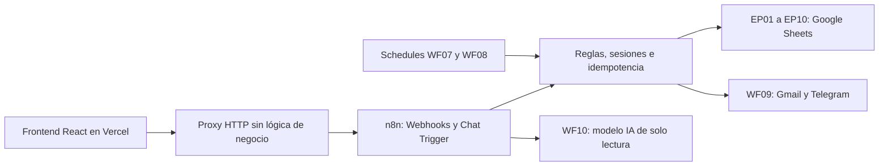

# EventPass — Nos encontramos aquí

Proyecto integrador de **Fabian Uribe**. Aplicación de encuentros de networking con frontend React, API y automatizaciones n8n y persistencia independiente por dominio en Google Sheets.

- Aplicación: https://eventpass-drab.vercel.app
- Repositorio: https://github.com/Sotwareeasy/EventPass.
- El estado de las verificaciones y los pendientes se registra en [docs/ESTADO.md](docs/ESTADO.md). Una compilación correcta no equivale a todas las pruebas externas aprobadas.

## Arquitectura



El navegador nunca lee ni escribe Google Sheets. El proxy de Vercel solo permite rutas y métodos conocidos, transmite la autorización al backend y conserva el código HTTP real. Los secretos OAuth, Telegram e IA permanecen en las credenciales cifradas de n8n.

## Tecnologías

React 19, TypeScript, Vite 7, Node.js, funciones Node de Vercel, n8n 2.40.5, Google Sheets, Gmail, Telegram y cadena LLM. n8n local utiliza Postgres, Redis y un worker con concurrencia 1. Node Test Runner prueba reglas y proxy; Playwright prueba la interfaz.

## Ejecutar localmente

```powershell
npm install
Copy-Item .env.example .env
npm run dev
```

La interfaz queda en http://127.0.0.1:5173. Ajustar `.env` con las URLs correspondientes y publicar los webhooks de producción de n8n. Para iniciar el entorno n8n utiliza la instalación Docker existente; este repositorio no contiene sus secretos ni reemplaza su configuración.

```powershell
npm run build
npm test
npm run check:workflows
npx playwright test
node scripts/smoke-http.mjs
```

Los tests de navegador usan Edge en modo headless y respuestas simuladas explícitas; no sustituyen la prueba de integración con Sheets ni envían notificaciones reales. `smoke-http` consulta los endpoints reales y comprueba rechazos sin sesión; el catálogo registra esa consulta en EP05.

## Variables

| Variable | Uso |
|---|---|
| `N8N_BASE_URL` | Local: http://127.0.0.1:5678. Vercel: origen HTTPS público de n8n, sin `/webhook` |
| `N8N_CHAT_URL` | URL de producción del Chat Trigger, incluyendo `/chat` |
| `VITE_TELEGRAM_BOT_USERNAME` | Nombre público del bot, sin `@`; opcional para mostrar el enlace |

Nunca colocar tokens, passwords, claves IA ni credenciales OAuth en variables `VITE_*`. `.env`, `config.local.json`, `.vercel/` y dependencias están excluidos de Git.

## Workflows y persistencia

| Workflow | Trigger | Archivo / hojas |
|---|---|---|
| WF01_usuarios_crud | Webhook | EP01_Usuarios / Usuarios, Auditoria_Usuarios |
| WF02_auth_sesiones | Webhook | EP02_Sesiones / Sesiones |
| WF03_vinculacion_telegram | Webhook y Telegram Trigger | EP03_Telegram / Codigos_Vinculacion, Vinculaciones |
| WF04_eventos_crud | Form Trigger protegido | EP04_Eventos / Eventos, Auditoria_Eventos |
| WF05_catalogo_publico | Webhook | EP05_Catalogo_Log / Consultas_Catalogo |
| WF06_inscripciones_crud | Webhook | EP06_Inscripciones / Inscripciones, Auditoria_Inscripciones |
| WF07_reasignacion_lista_espera | Schedule, cada 5 minutos | EP07_Reasignaciones / Reasignaciones |
| WF08_recordatorios | Schedule, cada 5 minutos | EP08_Recordatorios / Recordatorios |
| WF09_notificaciones | Execute Sub-workflow Trigger | EP09_Notificaciones / Notificaciones |
| WF10_eventpass_assistant | Chat Trigger | EP10_Soporte / Conversaciones, Mensajes |

Los flujos adicionales separan actualización y desactivación de perfil, logout, validación de sesión, consulta de Telegram y cambios de estado de eventos. `SW_validar_sesion` centraliza la autenticación. Los archivos `TEST_*` y scripts PowerShell son diagnósticos, no endpoints que deban quedar publicados.

## Endpoints

Prefijo n8n: `/webhook/eventpass`. Prefijo del frontend: `/api/eventpass`.

| Método / ruta | Función |
|---|---|
| POST `/usuarios` | Crear usuario; nombre, email, password |
| GET `/usuarios/me` | Perfil autenticado |
| PATCH `/usuarios/me` | Actualizar nombre |
| DELETE `/usuarios/me` | Desactivar; cuerpo `{"confirmacion":"DESACTIVAR"}` |
| POST `/auth/login` | Email y contraseña; devuelve token de sesión |
| POST `/auth/logout` | Cerrar sesión |
| GET `/auth/sesion` | Validar sesión |
| POST `/telegram/codigo` | Generar código temporal de vinculación |
| GET `/telegram/vinculacion` | Consultar vinculación |
| GET `/eventos` | Listado; filtros `categoria` o `evento_id` |
| POST `/inscripciones` | Crear; evento_id, nombre_acreditacion, observaciones |
| GET `/inscripciones` | Solo las del titular; no admite usuario_id externo |
| PATCH `/inscripciones` | Editar acreditación y observaciones por inscripcion_id |
| POST `/inscripciones/cancelar` | Cancelar por inscripcion_id |

Las solicitudes privadas llevan `Authorization: Bearer <token>`. Los errores usan `{ok:false,error:{codigo,mensaje}}`. El frontend valida tanto el HTTP como `ok`, sin convertir errores en éxitos por el contenido. No hay reintentos automáticos de mutaciones.

El chat se envía a `/api/eventpass/soporte`; el proxy utiliza `N8N_CHAT_URL`. El cuerpo contiene `action: sendMessage`, un UUID `sessionId` y `chatInput`.

## Seguridad, hashing y sesiones

Las contraseñas se procesan en n8n mediante scrypt y salt aleatorio, conservando el formato ya implementado. Se almacenan `password_hash` y `password_salt`, nunca la contraseña. Parámetros existentes: N=131072, r=8, p=1 y salt de 16 bytes. El login compara la derivación y genera un token aleatorio; Sheets almacena su huella SHA-256. La sesión vence a las ocho horas y se rechaza si está cerrada, expirada o el usuario está inactivo.

El frontend mantiene el token en memoria. Una recarga requiere iniciar sesión nuevamente. La vinculación de Telegram utiliza un código temporal de un solo uso; Sheets conserva su huella, no el código utilizable. El usuario envía `/vincular CODIGO` por chat privado.

## Estados e idempotencia

- Usuario: ACTIVO / INACTIVO.
- Sesión: ACTIVA / CERRADA / EXPIRADA.
- Evento: BORRADOR / PUBLICADO / CERRADO / CANCELADO.
- Inscripción: CONFIRMADA / LISTA_ESPERA / CANCELADA.
- Código Telegram: PENDIENTE / USADO / EXPIRADO / CANCELADO.
- Vinculación: ACTIVA / INACTIVA.

Crear rechaza otra inscripción activa del mismo usuario y evento con 409. Cancelar conserva la fila y añade auditoría; repetir devuelve 409 y no añade otra auditoría. Editar no acepta propietario, estado ni evento desde el cliente. La inscripción ajena devuelve el mismo 404 que una inexistente.

Google Sheets no ofrece una transacción que abarque las varias hojas. La ejecución serial del worker reduce carreras; no aumentar la concurrencia ni añadir workers sin incorporar un bloqueo distribuido. No modificar las hojas manualmente durante las operaciones. Guardado y auditoría se verifican por separado; ante estado incierto se revisan los registros antes de repetir.

## Lista de espera y reasignación

Se calcula capacidad menos CONFIRMADAS. Cuando existe lista de espera se preserva su prioridad. WF07 ordena por `fecha_inscripcion ASC` y desempata por ID, excluye usuarios inactivos, verifica duplicados/sobreaforo y procesa una promoción por ejecución. Reserva una fila EP07 antes de cambiar el estado, relee la inscripción y llama a WF09.

Una reserva inconclusa bloquea nuevas promociones del mismo evento hasta revisión. El proceso no promete recuperación transaccional automática. La frecuencia de cinco minutos y una promoción por ejecución es una decisión para el volumen académico y las cuotas de Sheets; hay que revisarla para cargas mayores.

## Recordatorios y notificaciones

WF08 selecciona un confirmado por ejecución dentro de las 24 horas anteriores al evento. Reserva `usuario_id:evento_id:24H` antes de notificar y registra ENVIADO, ERROR u OMITIDO. Una reserva existente impide repetir automáticamente el envío.

WF09 recibe usuario_id, tipo, titulo, mensaje, evento_id, inscripcion_id y clave_idempotencia. Consulta email y Telegram, persiste una reserva y trata cada canal por separado. Un fallo de Gmail sigue hacia Telegram. Estados por canal: PENDIENTE / ENVIADO / ERROR / NO_APLICA. Sin destinatario válido o con usuario inactivo, el canal queda NO_APLICA. Un resultado incierto requiere revisión manual para evitar duplicados; no se garantiza exactamente una entrega frente a fallos de red del proveedor.

## Asistente IA

WF10 tiene Chat Trigger, cadena LLM y modelo configurado mediante credenciales de n8n. Solo lee eventos públicos futuros; no se conectan herramientas que escriban en dominios de negocio. Persiste conversación y mensajes USER/ASSISTANT en EP10, identificados por conversation_id y visitor_id. Recoge hasta 12 mensajes recientes como contexto. El texto de eventos y mensajes se trata como datos no confiables. No recibe tokens, contraseñas ni datos de otros usuarios. Ante indisponibilidad del proveedor muestra una respuesta de contingencia, que no debe confundirse con una prueba IA aprobada.

## Importar y exportar

Los scripts de administración requieren la instalación Docker local existente y los permisos de su propietario. Revisar los IDs antes de usarlos en otra instancia. Importar por CLI despublica el flujo; publicar por CLI requiere reiniciar n8n para aplicar los cambios.

```powershell
node scripts/import-workflows.mjs WF09_notificaciones.json
node scripts/export-workflows.mjs WF09_notificaciones.json
```

`scripts/build-workflows.mjs` genera los nuevos bloques desde `workflow-src/domain.mjs` y los contratos existentes. No ejecutarlo después de modificaciones manuales sin revisar los cambios. `scripts/provision-sheets.mjs` prepara EP07–EP10 y guarda IDs en `config.local.json`; no repetir si hubo creación incierta sin comprobar Drive.

## Publicación y operación

La publicación Vercel utiliza `npm run build`, salida `dist` y `api/proxy.js`. Configurar las variables del servidor en el proyecto Vercel. El host de n8n y el túnel ngrok deben permanecer encendidos y accesibles para que la web funcione. Una URL Vercel accesible no vuelve permanente un backend que depende de un equipo local.

Consulta [docs/REQUISITOS.md](docs/REQUISITOS.md), [docs/ESTADO.md](docs/ESTADO.md) y [docs/OPERACION.md](docs/OPERACION.md) para la aceptación y los procedimientos de revisión.
